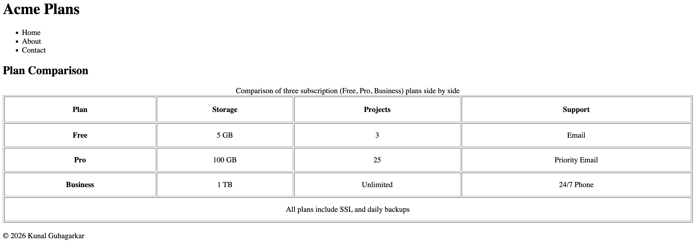

# Pricing Comparison Table

A single-page, unstyled HTML pricing comparison built with a real, accessible `<table>`. This project is based on the [roadmap.sh Pricing Comparison Table](https://roadmap.sh/projects/pricing-comparison-table) beginner frontend project.

The focus is on table structure and semantic page markup. Styling is intentionally left out and can be added later without changing the HTML structure.

## Preview



## What It Shows

A side-by-side comparison of three subscription plans (Free, Pro, Business) across storage, number of projects, and support level.

| Plan     | Storage | Projects  | Support        |
| -------- | ------- | --------- | -------------- |
| Free     | 5 GB    | 3         | Email          |
| Pro      | 100 GB  | 25        | Priority Email |
| Business | 1 TB    | Unlimited | 24/7 Phone     |

All plans include SSL and daily backups.

## Project Requirements Covered

- **Semantic page structure** using `<header>`, `<main>`, and `<footer>`.
- **Real table** with `<thead>` and `<tbody>` separating header rows from data rows.
- **`<caption>`** as the first child of the table, describing what is being compared.
- **Header scopes**: `scope="col"` on column headers and `scope="row"` on plan-name cells, so screen readers announce data in context.
- **Merged cell**: a `colspan="4"` footer cell spans the whole table for the note that applies to all plans.
- **Head metadata**: `<title>`, `<meta charset>`, and `<meta name="viewport">` are set.

## Getting Started

No build tools or dependencies are required.

1. Clone or download this repository.
2. Open `src/index.html` in any modern browser.

## File Structure

```
.
├── src
│   ├── images
│   │   └── preview.png
│   └── index.html
└── README.md
```

## Accessibility Notes

- The caption gives the table an accessible name.
- `scope` attributes tie each data cell to its column and row headers.
- Using real table elements (instead of `<div>` grids) means assistive technology can navigate the data by row and column.

## Author

Kunal Guhagarkar

## Credits

Project idea from [roadmap.sh](https://roadmap.sh/projects/pricing-comparison-table).
